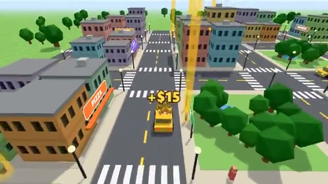

# Taxi Town

Race other taxis to every fare in town. A multiplayer starter game from [Multiplayer Agent](https://multiplayeragent.com): 3D, drop-in, 2–12 players, with bot taxis that fill the streets.

## How it plays

Drive your taxi around a little town. Stop next to someone waving to pick them up (the first taxi to stop gets them), then drop them at the place they ask for before their timer runs out. Faster rides tip more. Each shift ranks the drivers, and today's best earners go on the board.

**Controls:** WASD or arrow keys to drive, Space to brake, H to honk; on a phone, the steering and pedal buttons.

## Make it yours in the Game Builder

Open the [Game Builder](https://multiplayeragent.com), choose **Start from a starter game** and pick Taxi Town. It opens as version 1 in your studio, ready to play and publish. Then ask for changes, for example:

- Add rival police cars that slow you down
- Make it a snowy town with slippery roads
- Let players buy faster taxis with their earnings

## Run it yourself

1. Get a free publishable key (`pk_…`) at [multiplayeragent.com](https://multiplayeragent.com).
2. In `index.html`, put it in place of `pk_REPLACE_ME` in the `MP_CONNECT` block.
3. Serve the folder (for example `npx serve`) and open it. The 3D engine loads as a module, which browsers block from a file on disk.

Without a key it still runs, offline with the bots.

## How it is built

- One `index.html` plus three.js in `libs/`. The comment at the top of the script maps the code and explains the multiplayer.
- The town is a street grid built from `CONFIG` (roads, block size); the twelve named places are one list, `PLACES`.
- **Leaderboard:** Today's top earners: a fresh board every day.
- **Bots:** Bot taxis compete for fares until enough people join.
- **Host-run rules:** The host's browser places the passengers, decides who stopped first and pays the fares; if it leaves, the next player takes over.
- **Host-run rounds:** Shifts of two and a half minutes with a results card between them.
- **Live ops:** Turn on rush hour (`fareBonus` multiplies every fare) without touching the code; running events show at the top right.
- `?attract` runs it offline with bots only. The preview video is recorded from it.

## License

MIT. three.js in `libs/` is MIT too (Copyright 2010-2024 three.js authors).
